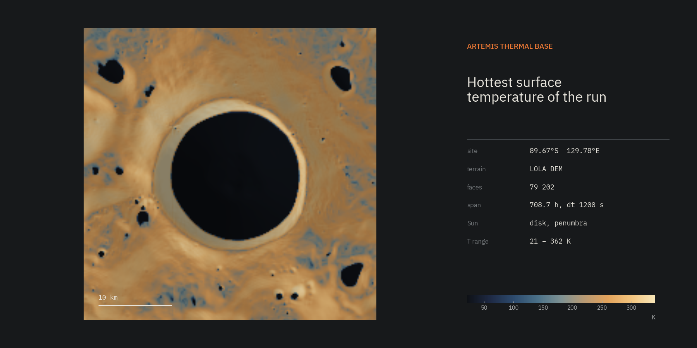

# ArtemisThermalBase

Illumination and regolith temperature for lunar polar terrain, on a laptop.



ArtemisThermalBase traces sunlight across a digital elevation model of the
lunar poles and follows the heat into a regolith column under every facet. It
answers the questions a landing site or a rover traverse raises: which ground
is lit and for how long, how hot and how cold it gets, how long the longest
night lasts, and where water ice would survive.

The image above is one lunar day over a 40 km window around Shackleton:
79 202 facets of LOLA topography, the Sun from NAIF DE440, a 16-ray solar disk
for penumbra, after one lunar day of spin-up. It took 9 minutes on an
eight-core laptop.

**Documentation:** <https://spaceengineerss.github.io/ArtemisThermalBase/>
· [Getting started](docs/guide.md) · [Physics](docs/physics.md)
· [Configuration](docs/configuration.md) · [Changelog](CHANGELOG.md)

## Install and run

```bash
git clone https://github.com/SpaceEngineerSS/ArtemisThermalBase.git
cd ArtemisThermalBase
python -m pip install -e ".[dem,ephemeris,gui]"

artemis run --duration 24     # synthetic Shackleton-sized bowl, about half a minute
artemis ui output             # look at it in the desktop app
```

Real terrain takes two downloads from the official sources, both checked:

```bash
python tools/fetch_research_data.py --group ephemeris
python tools/prepare_lola_dem.py --extent-km 40 --resolution-m 200 \
    --output data/processed/shackleton_lola_200m.tif
artemis run --config shackleton_preview \
    --dem data/processed/shackleton_lola_200m.tif --output output/shackleton
```

Python 3.11 or newer. Tested on Windows and Linux; macOS should work but is not in CI.

## What is inside

- Shadows from rays to many points of the solar disk, so penumbra and the
  grazing polar Sun come out right; a compiled BVH builds 583 000 triangles in
  about a second.
- The Sun from NAIF SPICE (research), Skyfield (preview) or an analytical
  polar model (offline), all rotated onto the terrain through one tested frame
  transformation.
- Terrain lowered onto the lunar sphere; optional one-bounce infrared between
  facets; Hapke albedo; roughness-adjusted emissivity.
- A 6 m regolith column per facet with temperature- and depth-dependent
  properties (Hayne et al. 2017), all columns advanced in one parallel call.
- Ice stability from Hertz–Knudsen sublimation, classified by the hottest
  temperature each place reaches.
- A research mode that refuses to run without a provenance-checked DEM, SPICE
  geometry and enough spin-up.
- A desktop app to set up runs, watch them, inspect a site and compare runs.

## Status

The geometry, ray tracing, conduction and data pipeline are tested on every
change, and the Sun direction agrees with SPICE. A quantitative comparison
with LRO Diviner temperatures has not been done yet; see
[Validation and limitations](docs/limitations.md) before you use a number
from here in a publication.

Version 0.5.0 changes results relative to 0.4: the Sun direction was wrong
for real ephemerides. Details in the [changelog](CHANGELOG.md).

## Development

```bash
python -m pip install -e ".[dev]"
python -m pytest
python -m ruff check .
python -m mypy -p core_engine -p simulation -p gui
python tools/build_docs.py --serve   # the documentation site on localhost:8000
```

How to contribute is in [CONTRIBUTING.md](CONTRIBUTING.md).

## Citing

If this software helps your work, cite it with [CITATION.cff](CITATION.cff)
and cite the data and models it uses (LOLA, NAIF DE440, Hayne et al. 2017),
listed in [Data](docs/data.md).

MIT licence. Mehmet Gümüş, 2026.
