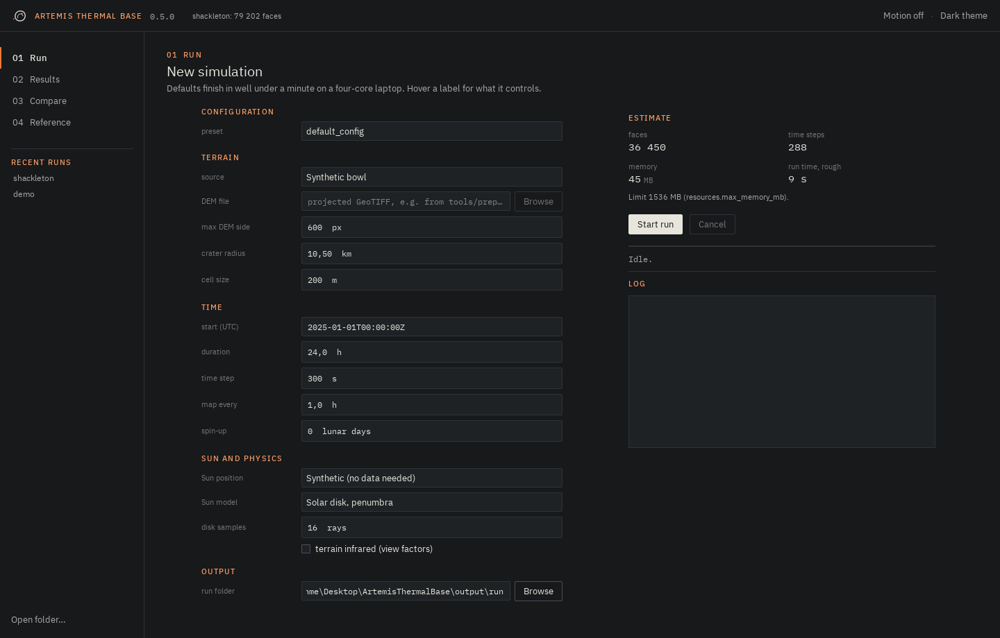
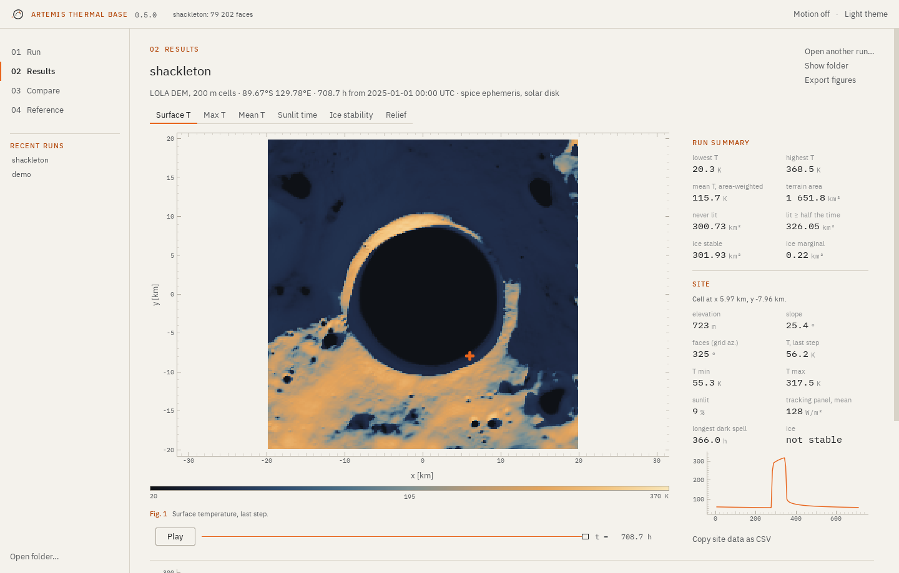
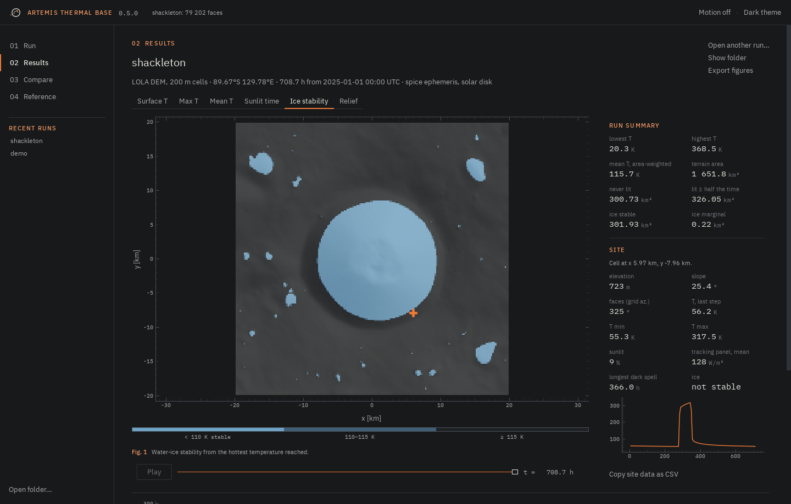
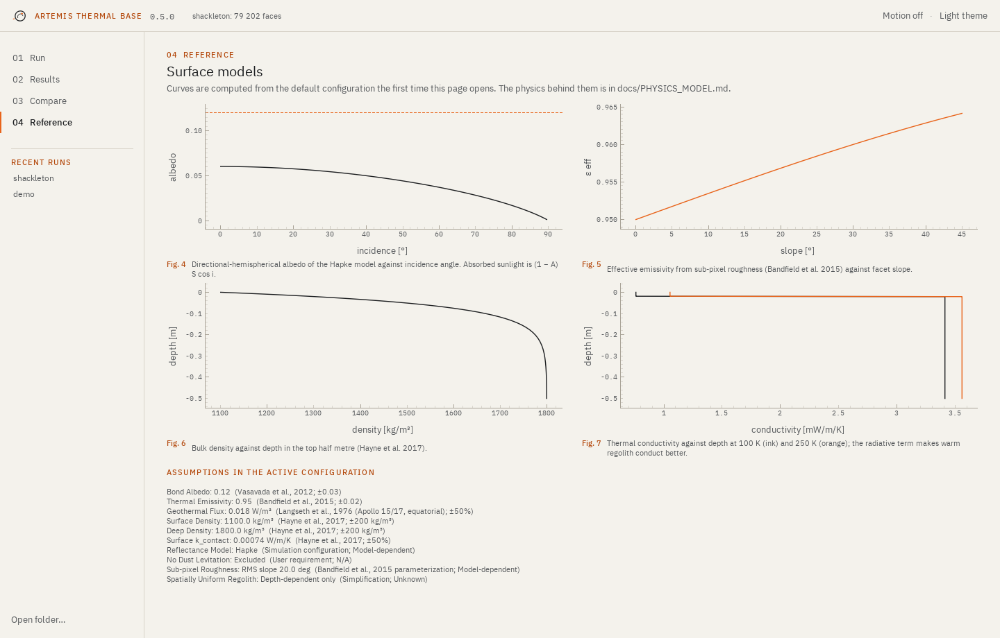

```bash
artemis ui                 # or: artemis-ui
artemis ui output/shackleton
```

The app is a window with four sections on the left, numbered like the
chapters of a report. Ctrl+1 to Ctrl+4 switch between them, Ctrl+O opens a run
folder, Ctrl+Enter starts a run. Runs you opened before are listed under the
sections, together with any run folders inside `./output`.

It follows the system's light or dark setting; the switch in the top right
overrides it. "Motion" turns the few interface animations off (or set
`ARTEMIS_REDUCE_MOTION=1`). Nothing in the app goes to the network.

## Run



The form starts from a bundled configuration (or any YAML file) and overrides
only what you change. Hover a label for what it controls.

The estimate on the right is worked out before anything runs: the number of
facets and time steps, the memory the run will need, and a rough duration.
The duration is calibrated by the runs you have already done on this machine,
so it gets better after the first one. If the memory estimate is above
`resources.max_memory_mb` the note under it turns red and the run would be
refused; change the cell size or switch off terrain infrared.

The simulation runs in a separate process. The window stays responsive, the
log streams in, and Cancel stops the run at the next time step. When it
finishes, the figures are rendered and the run opens in Results.

## Results



The tabs above the map switch layers:

| layer | shows |
|---|---|
| Surface T | temperature at the last step; with the slider, at any stored step |
| Max T, Mean T | per-cell maximum and mean over the recorded period |
| Sunlit time | share of steps with at least half of the solar disk visible |
| Ice stability | cold-trap class from the maximum temperature |
| Relief | elevation |

Drag on the map to pan, scroll to zoom, double-click to reset. The line under
the map shows the cursor position and the value under it.

**Run summary** gives area-weighted numbers for the whole map: temperature
range, area never lit, area lit at least half the time, and the area where ice
is stable or marginal.

**Site.** Click a cell to see what a lander or a rover would care about:

slope and facing
: from the cell's two triangles; facing is a grid azimuth (0° along +y)

T last, min, max
: surface temperatures of that cell

sunlit
: share of the recorded period with at least half the Sun visible

tracking panel, mean
: average sunlight on a panel that always faces the Sun, S × mean visible
  fraction. It ignores panel temperature and efficiency.

longest dark spell
: the longest run of stored steps with less than half the Sun visible, in
  hours. It is limited by the map interval and by the length of the run.

The small plot is the cell's temperature at every stored step. "Copy site data
as CSV" puts the numbers and the series on the clipboard.



## Compare

Two runs on the same grid (same DEM and cell size) can be subtracted cell by
cell: B minus A for maximum, mean or last-step temperature, or for sunlit
time. When a run finishes while another is open, the older one becomes A and
the new one B, so "change one setting, run again, compare" needs no clicks.
The panel lists the mean and RMS difference, the largest change and the share
of cells that changed by more than one unit.

## Reference

The surface models of the default configuration, drawn the first time you open
the page: Hapke albedo against incidence angle, roughness emissivity against
slope, density and conductivity against depth, and the assumptions the
configuration registers. Useful to check what a parameter change does before
spending a run on it.



## On slow machines

The app was written to stay smooth on a laptop with integrated graphics:

- maps are drawn as images, one pixel per DEM cell, not as point clouds;
- run folders are memory-mapped, so opening a 500k-facet run reads only what is drawn;
- files are read and statistics computed off the interface thread;
- the only animations are short fades and value transitions, and they can be switched off.
