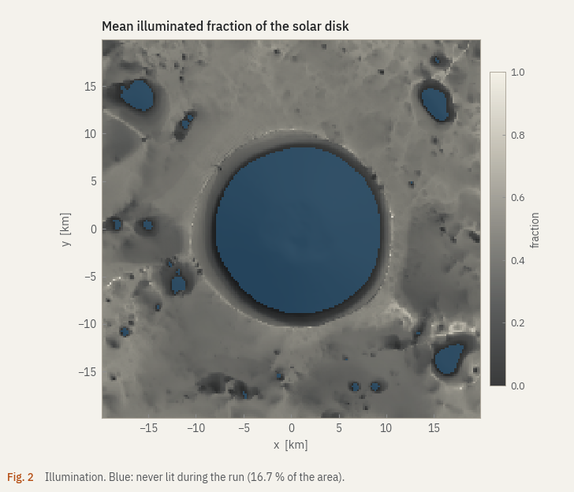

## Install

Python 3.11 or newer. The core needs NumPy, Numba, SciPy, Matplotlib and
PyYAML; everything else is optional and grouped into extras.

```bash
git clone https://github.com/SpaceEngineerSS/ArtemisThermalBase.git
cd ArtemisThermalBase
python -m pip install -e ".[dem,ephemeris,gui]"
```

| extra | adds | needed for |
|---|---|---|
| `dem` | rasterio | real GeoTIFF terrain |
| `ephemeris` | skyfield, spiceypy | real Sun positions |
| `gui` | PySide6, pyqtgraph | the desktop app |
| `docs` | markdown-it-py, Jinja2 | building this site |
| `dev` | all of the above, pytest, ruff, mypy | working on the code |

The first run compiles the numerical kernels and caches them next to the
source; that takes tens of seconds, once. `artemis warmup` does it ahead of
time.

## A first run

```bash
artemis run --duration 24
```

This simulates one Earth day over a synthetic, Shackleton-sized bowl: 36 450
facets at 200 m, a Sun 1.8° above the horizon, 288 steps of 5 minutes. On a
four-core laptop it takes 20 to 40 seconds. The run folder `output/` then holds
the arrays, a metadata file and five figures (`temperature.png`,
`illumination.png`, `ice_stability.png`, `timeline.png`, `hero.png`). Open the
folder in the app to explore it:

```bash
artemis ui output
```

A few variations:

```bash
artemis run --cratersize 2000 --duration 6          # a small crater, quick
artemis run --point-source --dt 900 --duration 72   # no penumbra, coarser steps
artemis run --spinup-cycles 1 --duration 708.7      # one lunar day of spin-up, then one recorded
```

`artemis run --help` lists every option; [Configuration](configuration.md)
lists every setting behind them.

## Real terrain

Two downloads, both from official sources and both checked by hash or
recorded with provenance.

```bash
# NAIF kernels for the Sun and the Moon's orientation (~47 MB)
python tools/fetch_research_data.py --group ephemeris

# A 40 km window of the LOLA DEM around Shackleton, reprojected to
# polar stereographic at 200 m (reads ~60 MB of the 8 GB global product)
python tools/prepare_lola_dem.py --extent-km 40 --resolution-m 200 \
    --output data/processed/shackleton_lola_200m.tif
```

Then run the bundled real-terrain preview, one spin-up lunar day plus one
recorded lunar day:

```bash
artemis run --config shackleton_preview \
    --dem data/processed/shackleton_lola_200m.tif --output output/shackleton
```

On an eight-core laptop (AMD Ryzen 5000 series) this took 9 minutes for 79 202
facets and 4 252 steps.
The figures on this site come from that run.



## The research configuration

`research_shackleton` is the configuration meant for results you would
defend. It refuses to start unless the DEM has a valid provenance sidecar, the
Sun comes from SPICE, and at least three lunar days of spin-up precede the
recorded period. It also uses 64 disk samples, terrain infrared with 512 rays
per facet and 2-minute steps, so expect hours on a workstation, not minutes.

```bash
python -m artemis_thermal.validation.check_research_readiness --dem data/processed/shackleton_lola_200m.tif
artemis run --config research_shackleton \
    --dem data/processed/shackleton_lola_200m.tif --output output/research
```

The readiness check loads everything the run will need and writes a JSON
report, so a missing kernel or a mismatched DEM fails in seconds rather than
after an hour.

## When something goes wrong

The run refuses to start
: The message names the limit. Most often it is `resources.max_memory_mb`: use a
  coarser cell size, a smaller DEM window, or turn off terrain infrared.

`FileNotFoundError` for kernels
: Run `python tools/fetch_research_data.py --group ephemeris` from the project
  folder, or give absolute paths in `ephemeris.kernel_files`.

The first run is slow to start
: That is Numba compiling. It happens once per install; `artemis warmup` moves
  it to a moment of your choosing.

The app does not start
: `artemis ui` needs the `gui` extra. On Linux, Qt also needs a few system
  libraries (`libegl1`, `libxkbcommon0`, `libfontconfig1`).
