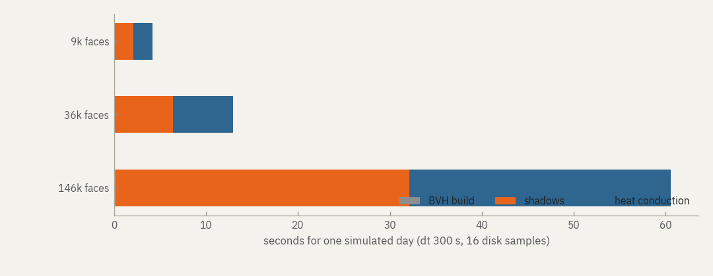

## Measured

One simulated day of the synthetic Shackleton bowl at three cell sizes:
16 solar-disk samples, Hapke, roughness, dt 300 s, no terrain infrared.
Columns start at their equilibrium temperature, as in a real run. Measured
with `python tools/bench.py` on an eight-core laptop (AMD Ryzen 5000 series,
16 threads, Windows 11, Python 3.11, Numba 0.63) with nothing else running.

| cell size | facets | BVH | shadows | conduction | one day | peak memory |
|---:|---:|---:|---:|---:|---:|---:|
| 400 m | 9 248 | 0.02 s | 2.1 s | 2.1 s | 4.2 s | 130 MB |
| 200 m | 36 450 | 0.07 s | 6.4 s | 6.5 s | 13.0 s | 158 MB |
| 100 m | 145 800 | 0.24 s | 31.9 s | 28.4 s | 61 s | 275 MB |

Cost grows linearly with the number of facets and the number of steps.
Shadows also grow with the number of disk samples, roughly in proportion. Terrain infrared adds a one-off Monte Carlo pass
(seconds to minutes) and a sparse product every step.

The real-terrain example in [Getting started](guide.md#real-terrain), 79 202
facets over two lunar days at 20-minute steps, took 9 minutes on the same
laptop.

## Compared with 0.4

| | 0.4 | 0.5 |
|---|---:|---:|
| BVH for 583 200 triangles | 338 s | 1.1 s |
| Conduction step, 20 000 columns | 41 ms | 34 ms |
| Memory of a one-month run at 1M facets, hourly output | grows to ~11 GB | flat, ~1.2 GB |
| Test suite | 97 s | 19 s |

Shadow maps from the new BVH are bit-for-bit identical to the old ones.

The starting temperature matters more than one would guess. From a uniform
200 K the cold columns need the full twenty Newton iterations for many steps;
our first benchmark did that by mistake and the conduction column was thirteen
times slower. The default equilibrium start avoids it.

## Memory

Per facet, a run needs roughly

| part | bytes |
|---|---:|
| thermal state, 101 nodes | 808 |
| BVH and triangle copies | 230 |
| mesh | 92 |
| per-step work arrays | 112 |
| terrain infrared, 128 rays | 4 096 |

so about 1.2 kB per facet without terrain infrared and 5 kB with it. The run
works out this estimate before it starts and stops if it exceeds
`resources.max_memory_mb` (1.5 GB by default). The app shows it as you type.

| machine | comfortable | with terrain infrared |
|---|---:|---:|
| 8 GB laptop | 1 million facets | 250 000 facets |
| 16 GB | 2.5 million | 600 000 |
| 32 GB workstation | 5 million | 1.2 million |

Above 1.2 million facets, raise `resources.max_memory_mb` to match the machine.

## When a run is too big or too slow

In order of effect:

1. **Coarser cells.** Doubling the cell size divides facets by four.
2. **A smaller window.** 20 km instead of 40 km is a quarter of the facets.
3. **Point source.** One ray per facet instead of sixteen; you lose penumbra.
4. **Longer steps.** 1200 s instead of 300 s for long previews; see the error
   table in [Configuration](configuration.md#solver).
5. **Fewer stored maps.** `--output-interval 21600` stores every six hours.
6. **Fewer threads,** if the machine must stay usable: `NUMBA_NUM_THREADS=4`.

The first run after installing compiles the kernels (tens of seconds) and
caches them; `artemis warmup` does this ahead of time.
