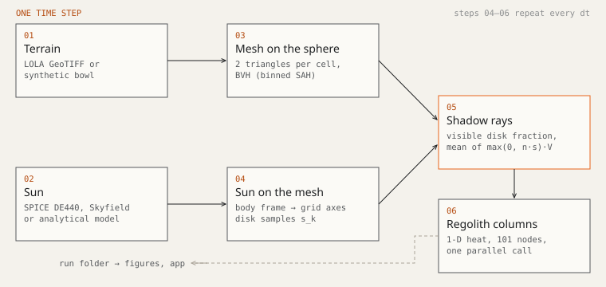
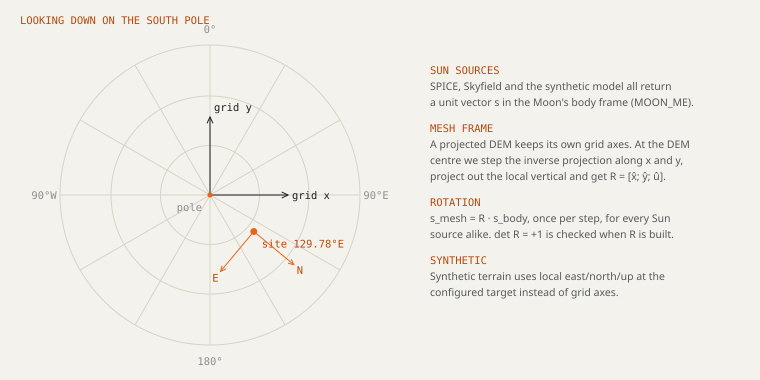
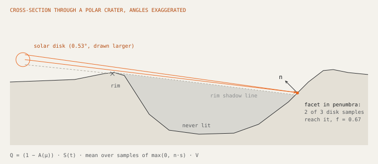
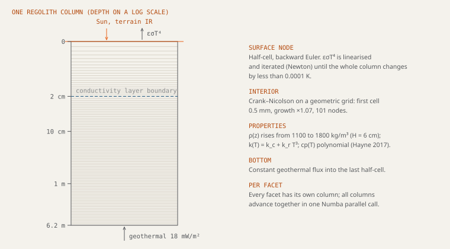

Every facet of the terrain is treated as the top of its own one-dimensional
regolith column. Facets talk to each other only through light: they shadow
each other from the Sun and, optionally, warm each other in the infrared.
Heat does not flow sideways between columns, which is a good approximation
when cells are much wider than the thermal skin depth (a few centimetres for
the diurnal wave, under a metre for the annual one).

At the surface of facet $i$ the balance is

$$
\underbrace{(1-A_i)\,S(t)\,F_i(t)}_{\text{sunlight}} + \underbrace{Q_{\text{IR},i}(t)}_{\text{terrain}} \;=\; \varepsilon_i\,\sigma\,T_{s,i}^4 \;-\; k\left.\frac{\partial T}{\partial z}\right|_{z=0},
$$

and below it heat diffuses down to a geothermal flux at the bottom. The
sections below go through each term.

## Terrain and frames

A DEM with $n_y \times n_x$ points becomes $2(n_y-1)(n_x-1)$ triangles, two per
grid cell, each with its own normal, area and centroid. Before that, every
vertex is lowered by the height of the lunar sphere below the tangent plane at
the DEM centre,

$$
\Delta z = R - \sqrt{R^2 - x^2 - y^2},
$$

115 m at 20 km. A flat DEM would let distant terrain stand too tall and cast
long shadows that do not exist; with the Sun 1.5° above the horizon, 115 m at
20 km is 0.3°.

The Sun direction has to arrive in the same frame as the mesh. Real DEMs come
in a map projection (polar stereographic for the poles), whose $x$ and $y$
axes are not east and north except along one meridian. We take the DEM centre,
step the inverse projection by 10 m along $x$ and along $y$, convert those
points to unit vectors on the sphere, remove the local vertical, and build a
right-handed rotation $\mathbf R = [\hat x;\,\hat y;\,\hat u]$ from the lunar
body frame to the mesh. Synthetic terrain uses local east, north and up at
the configured site instead. A test checks $\mathbf R$ against the same
construction with the DEM's own CRS through rasterio.

## Where the Sun is

Three sources, one interface: each returns the unit vector from the Moon to
the Sun in the lunar body frame and the Sun's distance.

SPICE
: NAIF DE440 with the lunar principal-axis kernel, in the mean-Earth/polar-axis
  frame `MOON_ME`, light-time and stellar aberration corrected. Kernels are
  pinned by SHA-256. This is the research path.

Skyfield
: The Moon-to-Sun vector from a JPL kernel (DE421 by default), rotated into the
  body frame with the IAU 2015 lunar orientation model, including its thirteen
  periodic terms. Against SPICE `MOON_ME` it is within 0.003° between 2025 and
  2030. Fine for previews; research mode does not accept it.

Synthetic
: The sub-solar point sits at a fixed latitude and travels once around the Moon
  per synodic month, starting at local noon over the site. Near the pole that
  keeps the Sun a degree or two above the horizon and moving in azimuth all
  day, which is what the polar Sun does. It needs no data and is the default.

Irradiance at the Moon is $S(t) = S_0\,(1\ \text{AU}/d(t))^2$ with
$S_0 = 1361\ \text{W m}^{-2}$ (Kopp & Lean 2011). The synthetic Sun uses $S_0$.

## Shadows and penumbra

The Sun is 0.53° wide, a third of its height above the horizon at the pole.
A point Sun would make every shadow edge a step; in reality a facet can see
part of the disk. We place $N$ directions $\hat s_k$ over the disk on a
Fibonacci spiral (equal solid angle each, 16 by default, 64 for research) and
cast one shadow ray per direction from just above the facet centroid.

Two numbers come out per facet:

$$
f_i = \frac1N\sum_k V_{ik}, \qquad
F_i = \frac1N\sum_k \max(0,\,\hat n_i\cdot\hat s_k)\,V_{ik},
$$

where $V_{ik}$ is 1 if ray $k$ escapes. $f_i$ is the visible fraction of the
disk, used for maps and statistics. $F_i$ multiplies the irradiance; it is
not $\cos\theta_i \cdot f_i$, which is biased exactly where it matters,
on steep walls and when the disk centre is just below a facet's horizon.

With `point_source_mode` a single ray goes to the disk centre and $F_i$ is
$\cos\theta_i$ or 0. Rays are traced through a bounding-volume hierarchy
built with a binned surface-area heuristic (16 bins, at most 4 triangles per
leaf) and tested with the Möller–Trumbore algorithm in double precision.
Faces turned away from the Sun skip the ray altogether.

## Absorbed sunlight

$$
Q_{\text{sun},i} = \bigl(1 - A(\mu_i)\bigr)\,S(t)\,F_i, \qquad \mu_i = \max(0,\hat n_i\cdot\hat s).
$$

With Hapke enabled (the default), $A(\mu)$ is the directional-hemispherical
albedo of the Hapke (2012) model with mature highland parameters
($w = 0.23$, double Henyey–Greenstein $b = 0.21$, $c = 0.70$, shadow-hiding
opposition $B_{S0} = 1$, $h_S = 0.065$), integrated over the exit hemisphere
once into a 2049-point table in $\mu$. It falls from about 0.06 at normal
incidence to near zero at grazing incidence. Without Hapke, $A$ is the Bond
albedo 0.12.

## Terrain infrared

Crater walls lit by the Sun at 300 K radiate onto a floor that the Sun never
reaches. With `view_factors.enabled`, every facet shoots cosine-weighted rays
into its upper hemisphere (128 by default, 512 for research). The fraction of
rays that hit facet $j$ first estimates the view factor $F_{ij}$, stored as a
sparse matrix. Each step the facet then absorbs

$$
Q_{\text{IR},i} = \varepsilon_i \sum_j F_{ij}\,\varepsilon_j\,\sigma\,T_{s,j}^4 ,
$$

one bounce of gray thermal emission, using the surface temperatures of the
previous step. Reflected infrared and scattered sunlight are not included.
Reciprocity $A_iF_{ij} = A_jF_{ji}$ is checked as an area-weighted aggregate
and reported; Monte Carlo noise keeps it at a few per cent.

Without terrain infrared, a permanently shadowed floor cools until it radiates
away only the geothermal flux, about 21 K. Diviner sees most south-polar cold
traps clearly warmer than that (Paige et al. 2010); for crater floors the
difference is mostly this term. Turn it on for anything quantitative inside
craters.

## Emission and roughness

The surface emits $\varepsilon_i\sigma T_s^4$. Unresolved roughness traps some
of the emitted radiation in small cavities, which raises the effective
emissivity. We use a simple parameterisation in the spirit of
Bandfield et al. (2015):

$$
\varepsilon_{\text{eff}} = \varepsilon_0 + (1-\varepsilon_0)\,K\,\sin\bar\theta,\qquad
\bar\theta = \sqrt{\theta_{\text{DEM}}^2 + \theta_{\text{rms}}^2},
$$

with $\varepsilon_0 = 0.95$, $K = 0.4$, the facet's resolved slope
$\theta_{\text{DEM}}$ and a sub-pixel RMS slope $\theta_{\text{rms}} = 20°$.
It moves $\varepsilon$ by less than 0.02. It is not Bandfield's full model,
which also changes the apparent temperature with viewing angle.

## Heat conduction

Below each facet,

$$
\rho(z)\,c_p(T)\,\frac{\partial T}{\partial t} = \frac{\partial}{\partial z}\left(k(T,z)\,\frac{\partial T}{\partial z}\right),
\qquad -k\left.\frac{\partial T}{\partial z}\right|_{z=z_{\max}} = Q_{\text{geo}} .
$$

**Grid.** 100 layers whose thickness grows geometrically from 0.5 mm by a
factor 1.07, reaching 6.2 m: fine enough at the top to resolve the diurnal
skin depth, deep enough that the annual wave has died out at the bottom.

**Interior nodes** use Crank–Nicolson on the non-uniform grid,

$$
C_j\,(T_j^{n+1} - T_j^{n}) = \tfrac12\left[\alpha_j (T_{j-1} - T_j) + \gamma_j (T_{j+1} - T_j)\right]^{n+1}
+ \tfrac12\left[\cdots\right]^{n},
$$

with $C_j = \rho_j c_{p,j}/\Delta t$, $\alpha_j = k_{j-\frac12}/(\Delta z_{j-1}\overline{\Delta z}_j)$,
$\gamma_j = k_{j+\frac12}/(\Delta z_j\overline{\Delta z}_j)$ and interface
conductivities taken as harmonic means.

**The surface node** is a half cell treated with backward Euler. Its radiative
loss is stiff: with a 0.5 mm cell, a 300 s step and $T^4$ in the boundary,
Crank–Nicolson can oscillate at sunrise and sunset. The fully implicit step is
L-stable and does not. The $T^4$ term is linearised around the latest
iterate,

$$
\varepsilon\sigma T^4 \approx \varepsilon\sigma\left(4\tilde T^3 T - 3\tilde T^4\right),
$$

and the tridiagonal system is solved again (Newton iteration, Thomas
algorithm) until the largest change anywhere in the column is below
$10^{-4}$ K (at most 20 iterations).

**The bottom node** is a Crank–Nicolson half cell that receives the
geothermal flux, 18 mW m⁻² (Apollo 15 and 17; Langseth et al. 1976). The flux
enters the column once, there; it is not added at the surface.

How large a time step is safe is measured in
[Configuration](configuration.md#solver): 300 s stays within 0.13 K of a 30 s
reference over a lunar day.

## Regolith properties

Hayne et al. (2017), as used for the Diviner global regolith model:

$$
\rho(z) = \rho_d - (\rho_d - \rho_s)\,e^{-z/H}, \qquad \rho_s = 1100,\ \rho_d = 1800\ \text{kg m}^{-3},\ H = 6\ \text{cm};
$$

$$
k(T,z) = k_c(z) + k_r(z)\,T^3,
$$

with $k_c = 7.4\times10^{-4}$, $k_r = 2\times10^{-11}$ above 2 cm and
$k_c = 3.4\times10^{-3}$, $k_r = 10^{-11}$ below (W m⁻¹ K⁻¹ and
W m⁻¹ K⁻⁴). The radiative $T^3$ term makes hot regolith conduct several times
better than cold. Heat capacity is the polynomial

$$
c_p(T) = c_0 + c_1 T^{1/2} + c_2 T + c_3 T^2 + c_4 T^3,
$$

floored at 8 J kg⁻¹ K⁻¹ so it stays positive near absolute zero.

## Starting state and spin-up

A column's deep temperature remembers months of history, so the starting
state matters. By default each column starts isothermal at the temperature
that radiates away its day-mean absorbed sunlight,

$$
T_0 = \left(\frac{(1-A)\,\overline{S F} + Q_{\text{geo}}}{\varepsilon\sigma}\right)^{1/4},
$$

with $\overline{SF}$ from 24 point-source shadow maps spread over one synodic
month. This removes most of the start-up transient for the cost of 24 cheap
ray-tracing passes. For results, spin-up lunar days are simulated before the
recorded period and the change between the last two is reported; research
mode requires three.

## Ice stability

Water ice exposed to vacuum loses mass at the Hertz–Knudsen rate

$$
E(T) = p_v(T)\sqrt{\frac{m}{2\pi k_B T}},
$$

with the vapour pressure of hexagonal ice from Murphy & Koop (2005),
$\ln p_v = 9.550426 - 5723.265/T + 3.53068\ln T - 0.00728332\,T$ (Pa).
At 110 K that is $4.5\times10^{-15}$ kg m⁻² s⁻¹, a metre of ice in about
6 billion years; at 200 K the same metre lasts about 50 days.

Each facet is classified by the **hottest** surface temperature it reaches
during the recorded period: stable below 110 K, marginal to 115 K, not stable
above (Zhang & Paige 2009; Hayne et al. 2015). Short runs see only part of a
lunar day and can miss the hottest hours; classify from at least one full day.

## References

- Bandfield, J. L., et al. (2015). Lunar surface roughness derived from LRO Diviner Radiometer observations. *Icarus* 248, 357–372.
- Crank, J., & Nicolson, P. (1947). A practical method for numerical evaluation of solutions of partial differential equations of the heat-conduction type. *Proc. Cambridge Phil. Soc.* 43, 50–67.
- Hapke, B. (2012). *Theory of Reflectance and Emittance Spectroscopy*, 2nd ed. Cambridge University Press.
- Hayne, P. O., et al. (2015). Evidence for exposed water ice in the Moon's south polar regions from LRO ultraviolet albedo and temperature measurements. *Icarus* 255, 58–69.
- Hayne, P. O., et al. (2017). Global regolith thermophysical properties of the Moon from the Diviner Lunar Radiometer Experiment. *JGR Planets* 122, 2371–2400.
- Kopp, G., & Lean, J. L. (2011). A new, lower value of total solar irradiance. *GRL* 38, L01706.
- Langseth, M. G., Keihm, S. J., & Peters, K. (1976). Revised lunar heat-flow values. *Proc. Lunar Sci. Conf.* 7, 3143–3171.
- Mazarico, E., et al. (2011). Illumination conditions of the lunar polar regions using LOLA topography. *Icarus* 211, 1066–1081.
- Möller, T., & Trumbore, B. (1997). Fast, minimum storage ray-triangle intersection. *J. Graphics Tools* 2(1), 21–28.
- Murphy, D. M., & Koop, T. (2005). Review of the vapour pressures of ice and supercooled water for atmospheric applications. *QJRMS* 131, 1539–1565.
- Archinal, B. A., et al. (2018). Report of the IAU Working Group on Cartographic Coordinates and Rotational Elements: 2015. *Celest. Mech. Dyn. Astr.* 130, 22.
- Paige, D. A., et al. (2010). Diviner Lunar Radiometer observations of cold traps in the Moon's south polar region. *Science* 330, 479–482.
- Park, R. S., et al. (2021). The JPL Planetary and Lunar Ephemerides DE440 and DE441. *AJ* 161, 105.
- Wald, I. (2007). On fast construction of SAH-based bounding volume hierarchies. *Proc. IEEE Symp. Interactive Ray Tracing*, 33–40.
- Zhang, J. A., & Paige, D. A. (2009). Cold-trapped organic compounds at the poles of the Moon and Mercury. *GRL* 36, L16203.

The code for each section: [frames](../artemis_thermal/core_engine/frames.py),
[ephemeris](../artemis_thermal/data_ingestion/ephemeris.py), [ray tracer](../artemis_thermal/core_engine/raytracer.py),
[solar disk](../artemis_thermal/core_engine/solar_disk.py), [Hapke](../artemis_thermal/core_engine/reflectance.py),
[view factors](../artemis_thermal/core_engine/view_factors.py), [roughness](../artemis_thermal/core_engine/roughness.py),
[conduction](../artemis_thermal/thermal_solver/crank_nicolson.py), [volatiles](../artemis_thermal/thermal_solver/volatiles.py).
